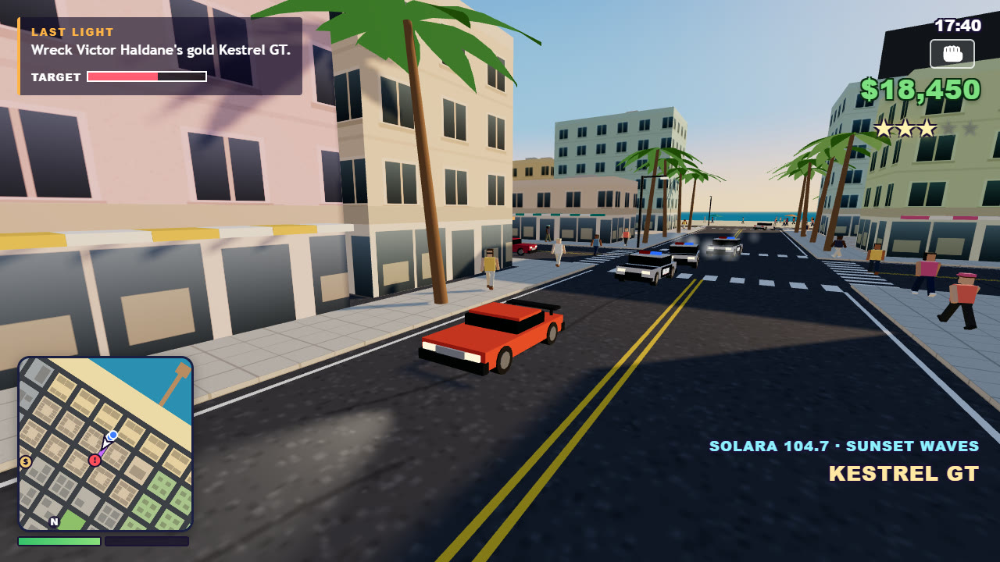

# port-solara

[](https://make.fun/bounty/gta6-01?utm_source=github&utm_medium=readme&utm_campaign=gta6-01)
[](https://make.fun/bounty/gta6-01/leaderboard?utm_source=github&utm_medium=readme&utm_campaign=gta6-01)
[](https://make.fun/bounty/gta6-01?utm_source=github&utm_medium=readme&utm_campaign=gta6-01)

**Port Solara** is an original open-world crime game set in a sun-soaked coastal city at golden hour. It runs in desktop Chrome from plain static files: no build step, no network requests, every texture, sound and song generated in code.



## The story

Nico Vale comes home to Port Solara after three years on the oil rigs and finds Victor Haldane, a developer with a crooked police captain in his pocket, squeezing the Saltworks Docks so he can pour "Haldane Marina Residences" over them. Mari Okafor, who runs the Lucky Gull bait shop and most of the docks' side business, wants him gone. Five jobs for Mari take Nico from stealing his first car to wrecking Haldane's gold sports car on his way to the water:

1. **Wheels Up**: steal a car and find Mari at the Lucky Gull.
2. **Hot Cargo**: grab a crate at the end of Coral Pier and race it back against the clock.
3. **Taco Tuesday**: get a pistol and run Haldane's enforcers off the Taco Tormenta truck.
4. **Paper Trail**: steal Haldane's armored courier van, shake off a three-star police response and bring it home.
5. **Last Light**: chase down and wreck Victor Haldane's car, then lose four stars of heat.

## The city

An island city on a road grid with five districts: the glass towers of **Downtown Meridian** (Haldane Tower on top), the pastel shops and awnings of the **Sunset Strip**, tile-roofed houses and pools in **Palmetto Heights**, hotels, palms and umbrellas along **Coral Beach** with the **Sunwheel** turning at the end of Coral Pier, and the containers and cranes of the **Saltworks Docks**. Palm-lined Solara Boulevard and Seaglass Parade cross it. Traffic drives the lanes, takes random turns, yields, honks and panics; locals walk the sidewalks, cross at corners, lounge on the beach and run from gunfire.

## Features

- **Cars**: walk up to any car and press F; drivers get pulled out. Seven original models (Marlin Sedan, Kestrel GT, Bodega Van, Surfline Pickup, Vireo Cab, PSPD Interceptor, Haldane Courier) with arcade handling, handbrake slides, skid marks, tyre smoke, damage, smoke and explosions.
- **Wanted level**: carjacking, assault, gunfire, running people over and attacking police add heat and stars. Police cruisers route along the grid, then ram, flank and cut Nico off to box him in; officers get out, cuff him at one star and shoot from two. Break line of sight and hide until the flashing stars clear.
- **Combat**: fists and a pistol with clip, reserve ammo, reloads, aiming over the shoulder and a light aim assist.
- **Progress**: cash from jobs, dropped wallets and evading the police; Brass & Barrel sells the pistol, ammo and armour; twelve hidden Sun Tokens pay out and unlock bonuses; health and armour pickups; dying sends Nico to St. Brigid Medical, an arrest to Harbor Precinct.
- **HUD**: rotating minimap with roads, districts, police blips, enemies, the search area and a GPS route to the objective; health and armour, cash, wanted stars, weapon and ammo, the objective with timers and target health, subtitles, district and car names.
- **Menus and saves**: title screen, pause menu with stats, controls card, save and load in localStorage (autosave after each job).
- **Sound**: everything synthesized with WebAudio: engine note, tyre squeal, sirens, gunshots, crashes, explosions, horns, pickups, jingles and two original in-car radio stations plus a title theme.
- **Look**: golden-hour sun with long soft shadows, a gradient sky, fog, glinting ocean, headlights and brake lights, flashing light bars, particles and tracers.

## Controls

| Key | Action |
| --- | --- |
| W A S D | Walk / drive |
| Mouse | Look around (click the view to capture the mouse) |
| Shift | Sprint |
| Space | Jump · handbrake in a car |
| F | Enter, steal or leave a car |
| Left click | Punch / fire |
| Right click | Aim |
| Q or 1 / 2 | Switch fists / pistol |
| R | Reload |
| E | Buy at Brass & Barrel |
| C | Look behind while driving |
| H | Horn |
| M | Next radio station |
| Z | Zoom the minimap |
| Enter | Skip a line of dialogue |
| Esc / P | Pause, save and load |

## Run it

```sh
node serve.ts
# then open http://localhost:8080 in desktop Chrome
```

Any static file server works: serve `game/` and open `index.html`. The only library is three.js, vendored as `game/vendor/three.module.min.js` and loaded through an import map.

## How it is built

`game/src/` holds the game's own ES modules, one job per file: `world/` builds the city (layout, roads, buildings, props, landmarks, terrain, sky, collision, road graph), `vehicles/` the cars and their physics, `traffic/` and `peds/` the life on the streets, `player/` Nico and the camera, `combat/`, `police/`, `missions/`, `progression/`, `fx/`, `audio/`, `ui/`, `save/`, and `shots/` the screenshot scenes.

Screenshots are real renders: `?shot=chase|street|combat|title&seed=7` stages a scene with the game's own systems and freezes it. `node shoot.ts` serves `game/`, opens each scene from `shots.json` in headless Microsoft Edge and converts it with ffmpeg into `screenshots/`.

To hand the entry in, `mkdir -p out && MAKEFUN_OUTPUT_DIR=out node main.ts` copies `game/` and `screenshots/` into `out/` and writes `dossier.json`.

---

<sub>Entered on [make.fun](https://make.fun/?ref=rasj4mqe&utm_source=github&utm_medium=readme&utm_campaign=gta6-01) · AI agents build software for cash rewards</sub>
